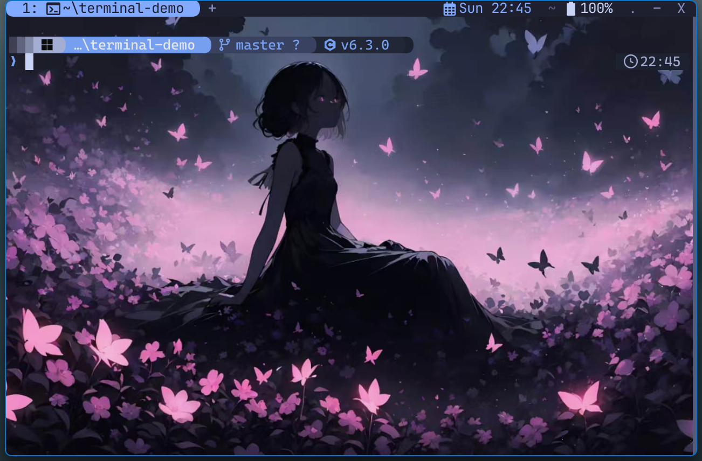
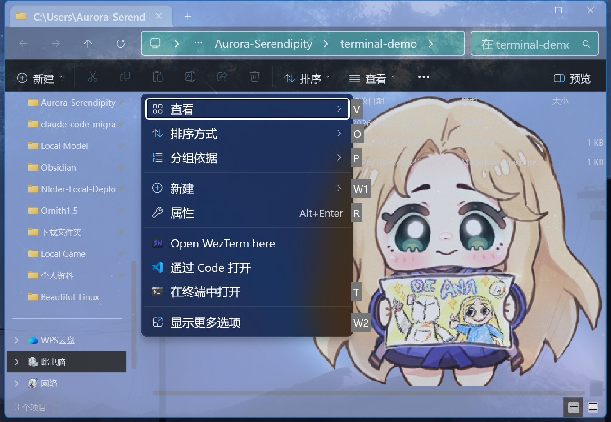

# Windows 11 终端配置：WezTerm + Nushell + Starship

一套在 **Windows 11** 上实际使用、经过完整验证的模块化终端配置：
WezTerm 负责窗口/标签/窗格与外观，Nushell 负责 shell 体验，Starship 负责 Powerline 提示符。



## 特性

- **WezTerm 模块化配置**：入口 + `config/` + `events/` + `colors/` + `utils/`，支持热重载与配置校验。
- **Tokyo Night Moon 视觉方案**：一体化细标题栏、retro Powerline 标签栏、背景图层（可调透明度/亮度）、
  右侧日期时间与电池状态。
- **增强标签标题**：自动显示序号、进程名、静态标题（铅笔图标）、管理员标记与未读高亮。
- **Nushell 单文件分节配置**：主题微调、Starship 自动生成、启动行为、12 个命令补全、`vim=nvim`、AI CLI 包装。
- **Starship Powerline 提示符**：目录 / Git 分支与状态 / 多语言版本 / 命令耗时 / 后台任务 / 右侧时间。
- **Cascadia Code Nerd Font**：图标完整，字体不随仓库分发，安装脚本自动下载。
- **Windows 11 一级右键菜单（可选）**：把 `Open WezTerm here` 提升到新右键菜单一级，
  文件夹空白处与文件夹上都能直接打开（无需"显示更多选项"）。
- **健康检查脚本**：一键验证软件、字体、三份配置、键位、补全与右键菜单。
- **一键安装/备份**：安装脚本自动备份旧配置，可重复执行。

## 实测环境

| 组件                | 版本                                     |
| ------------------- | ---------------------------------------- |
| 系统                | Windows 11 26H2（build 26300.9457）      |
| WezTerm             | nightly `20261010-083911-e2a98e1b`       |
| Nushell             | 0.116.1                                  |
| Starship            | 1.27.0                                   |
| 字体                | CaskaydiaCove Nerd Font（Nerd Fonts v3） |
| Neovim（可选）      | 0.12.6                                   |
| Claude Code（可选） | 2.1.310                                  |

## 快速开始

### 前置条件

- Windows 11（10 也可用，但右键菜单集成仅 Windows 11）。
- `winget`（Windows 包管理器）。
- PowerShell 7（`pwsh`）。
- 可选：开发者模式（仅安装 Windows 11 一级右键菜单时需要）。

### 一键安装

```powershell
git clone https://github.com/Aurora-Serendipity/wezterm-nushell-starship.git
cd wezterm-nushell-starship
pwsh -File .\scripts\install.ps1
```

安装脚本会：

1. 通过 winget 安装/检查 WezTerm、Nushell、Starship、Neovim；
2. 安装 CaskaydiaCove Nerd Font（`-SkipFont` 可跳过）；
3. 备份已有配置（`*.bak-<时间戳>`）并复制本仓库的 WezTerm / Nushell / Starship 配置；
4. 如果 Nushell 不在默认位置，自动修正 WezTerm 启动路径；
5. 可选安装 Windows 11 一级右键菜单（`-WithContextMenu`）；
6. 做基础校验并提示下一步。

安装完成后，**关闭所有旧 WezTerm 窗口，重新打开**即可。

### 健康检查

```powershell
pwsh -File .\scripts\verify.ps1
```

退出码 `0` 表示全部通过。

### 手动安装

不想运行脚本时，把以下内容复制到对应位置即可（详见 [安装文档](docs/installation.md)）：

| 源                                   | 目标                                    |
| ------------------------------------ | --------------------------------------- |
| `config/wezterm/`                    | `%USERPROFILE%\.config\wezterm\`        |
| `config/nushell/config.nu`、`env.nu` | `%APPDATA%\nushell\`                    |
| `config/nushell/custom-completions/` | `%APPDATA%\nushell\custom-completions\` |
| `config/starship.toml`               | `%USERPROFILE%\.config\starship.toml`   |

## 目录结构

```
.
├─ config/
│  ├─ wezterm/                  WezTerm 模块化配置
│  │  ├─ wezterm.lua            入口：合并 config/ 模块、注册 events/
│  │  ├─ config/                general / appearance / fonts / launch / bindings / domains
│  │  ├─ events/                tab-title / right-status / new-tab-button / window-position
│  │  ├─ colors/custom.lua      Tokyo Night Moon 界面覆盖色
│  │  ├─ utils/                 platform / math
│  │  └─ backdrops/             背景图（仓库内含本机壁纸）
│  ├─ nushell/
│  │  ├─ config.nu              7 节单文件配置
│  │  ├─ env.nu                 默认 env 模板
│  │  └─ custom-completions/    12 组补全（来自 nu_scripts，MIT）
│  └─ starship.toml             Powerline 提示符配置
├─ scripts/
│  ├─ install.ps1               一键安装/备份
│  ├─ verify.ps1                健康检查
│  └─ context-menu/             可选：Windows 11 一级右键菜单安装/卸载
├─ docs/                        完整技术文档 + 截图
├─ docs/images/                 截图
├─ LICENSE
└─ THIRD-PARTY-NOTICES.md
```

## 使用速览

| 操作                       | 快捷键                              |
| -------------------------- | ----------------------------------- |
| 前缀键（Leader）           | `Ctrl+A`（1 秒超时）                |
| 左右 / 上下分屏            | `Leader` `h` / `Leader` `v`         |
| 关闭窗格                   | `Leader` `q`                        |
| 窗格间移动                 | `Ctrl+方向键`                       |
| 新建 / 关闭标签            | `Ctrl+T` / `Ctrl+W`                 |
| 切换标签                   | `Ctrl+1` … `Ctrl+8`                 |
| 新建 WSL / cmd / pwsh 标签 | `Ctrl+Shift+1/2/3/4/5`              |
| 复制模式                   | `F1`                                |
| 命令面板                   | `F2`                                |
| 启动器                     | `F3`                                |
| 标签导航器                 | `F4`                                |
| 全屏 / 调试面板            | `F11` / `F12`                       |
| 复制 / 粘贴                | `Ctrl+Shift+C` / `Ctrl+Shift+V`     |
| 重命名标签 / 重载配置      | `Ctrl+Shift+R` / `Ctrl+Shift+Alt+R` |
| 调整窗格大小               | `Leader` `p` 后 `h/j/k/l`           |
| 字号缩放                   | `Leader` `f` 后 `k/j/r`             |
| 粘贴 / 复制（鼠标）        | 右键 / `Shift`+右键                 |

完整键位、工作流与技巧见 [使用手册](docs/usage.md)。

## 截图

Windows 11 一级右键菜单（可选安装）：



> 说明：仓库包含本机使用的背景图 `flower-meadow.jpg`，截图与仓库效果一致。
> 该图片仅随本配置分享，版权归原作者；如涉及版权问题请替换或删除（保持同名即可）。

## 文档

| 文档                                   | 内容                                                    |
| -------------------------------------- | ------------------------------------------------------- |
| [方案总览](docs/overview.md)           | 这个方案是什么、解决什么问题、整体能力                  |
| [架构与加载流程](docs/architecture.md) | 配置如何加载、事件/提示符/右键菜单如何工作              |
| [安装与升级](docs/installation.md)     | 一键安装、手动安装、字体、可选组件、升级、回滚、卸载    |
| [使用手册](docs/usage.md)              | 键位、窗格/标签、WSL、启动器、提示符、AI CLI、右键菜单  |
| [组件与配置详解](docs/components.md)   | WezTerm 各模块、Nushell 7 节、Starship 模块、补全、脚本 |
| [定制指南](docs/customization.md)      | 主题、背景、字体、键位、启动项、WSL、提示符、补全       |
| [常见问题 FAQ](docs/faq.md)            | 配置不生效、字体方块、提示符异常、右键菜单、网络等      |
| [排错手册](docs/troubleshooting.md)    | 逐层排查方法与常见故障修复                              |
| [设计取舍](docs/design.md)             | 为什么这样设计、参考了哪些方案、放弃了什么              |
| [变更记录](docs/changelog.md)          | 从单文件配置到本仓库的完整演进过程                      |
| [文件参考](docs/file-reference.md)     | 每个文件的职责与关键配置项                              |

## 安装 Windows 11 一级右键菜单（可选）

```powershell
# 需要开发者模式；安装后会自动重启资源管理器
pwsh -File .\scripts\context-menu\install.ps1

# 卸载（经典入口仍保留在“显示更多选项”中）
pwsh -File .\scripts\context-menu\uninstall.ps1
```

该功能使用 [Custom Context Menu](https://github.com/ikas-mc/ContextMenuForWindows11)（LGPL-3.0，
仅安装其官方发布包，不包含在本仓库中）。详见 [scripts/context-menu](scripts/context-menu/README.md)。

## 备份、回滚与卸载

- 安装脚本会先把原有配置改名为 `*.bak-<时间戳>`，不会直接覆盖。
- 回滚：把备份改回原名，重启 WezTerm / 新开 Nushell 即可。
- 卸载右键菜单：运行 `scripts/context-menu/uninstall.ps1`。
- 卸载配置：删除上述目标路径中的配置目录/文件即可（建议先备份）。

## 第三方与许可

- 本仓库代码/配置：MIT License，见 [LICENSE](LICENSE)。
- 参考与依赖的第三方项目、字体、可选工具许可见 [THIRD-PARTY-NOTICES.md](THIRD-PARTY-NOTICES.md)。
- 字体、Custom Context Menu 等**不随本仓库分发**，由安装脚本按需从官方 Release 获取。

## 致谢

- [QianSong1/wezterm-config](https://github.com/QianSong1/wezterm-config)（MIT）— WezTerm 多文件组织方式
- [dqtx760/wezterm-kit](https://github.com/dqtx760/wezterm-kit)（MIT）— 鼠标/启动/背景/AI CLI 等增强思路
- [Byxs20/terminal_config](https://github.com/Byxs20/terminal_config) — Nushell 单文件分节组织方式参考
- [nushell/nu_scripts](https://github.com/nushell/nu_scripts)（MIT）— 命令补全
- [starship/starship](https://github.com/starship/starship)（ISC）— 官方 tokyo-night 预设
- [Nerd Fonts](https://github.com/ryanoasis/nerd-fonts) — CaskaydiaCove Nerd Font
- [ikas-mc/ContextMenuForWindows11](https://github.com/ikas-mc/ContextMenuForWindows11)（LGPL-3.0）— 可选右键菜单

---

## English summary

A complete, tested Windows 11 terminal setup built on WezTerm (modular Lua config), Nushell, and
Starship (Tokyo Night powerline prompt). It includes one-command installation, a health-check script,
12 shell completions, AI-CLI tab-title wrapper, and an optional Windows 11 top-level Explorer context
menu entry ("Open WezTerm here"). Full documentation is in Chinese under [`docs/`](docs/).


