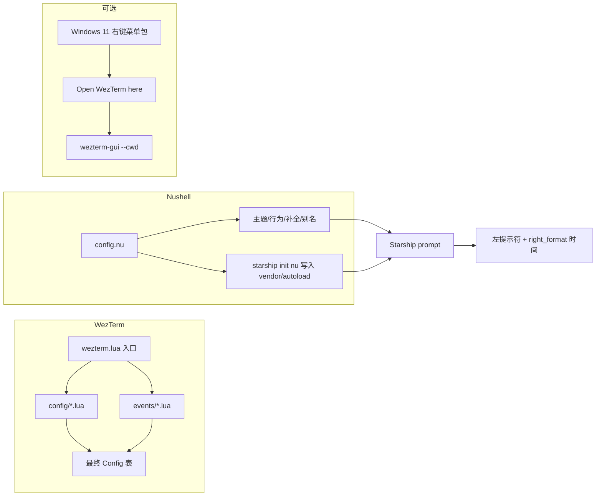
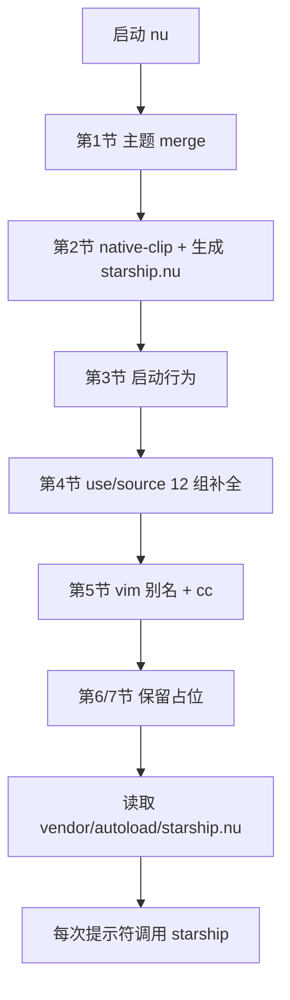
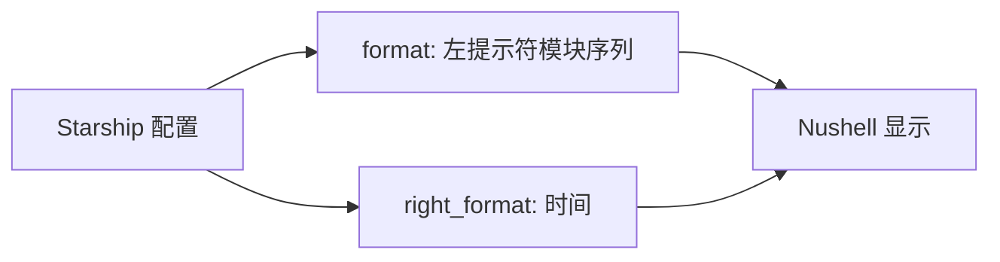
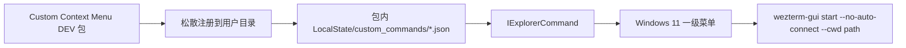
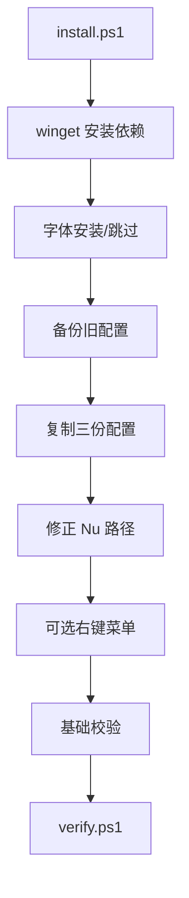

# 架构与加载流程

> 返回：[README](../README.md) · 相关：[组件详解](components.md) · [安装](installation.md)

## 1. 总览



三份配置互相独立，通过系统约定衔接：

- WezTerm 启动 Nushell（`default_prog`）；
- Nushell 启动时把 `starship init nu` 写进 `vendor/autoload/starship.nu`，由 Nushell 自动加载；
- Starship 读取 `~/.config/starship.toml` 生成提示符；
- Windows 右键菜单直接调用 `wezterm-gui.exe start --no-auto-connect --cwd <目录>`。

## 2. WezTerm 配置加载

入口：`config/wezterm/wezterm.lua`

```lua
local Config = require("config")

require("events.right-status").setup()
require("events.tab-title").setup()
require("events.new-tab-button").setup()
require("events.window-position").setup()

return Config:init()
  :append(require("config.appearance"))
  :append(require("config.bindings"))
  :append(require("config.domains"))
  :append(require("config.fonts"))
  :append(require("config.general"))
  :append(require("config.launch")).options
```

### 2.1 `config/init.lua`：累加器 + 校验

- `Config:init()` 创建配置表；
- `append(module)` 合并模块；
- 出现重复配置项时打印告警，保留先加载的值；
- 最终用 `wezterm.config_builder()` 构造配置，尽早暴露非法项。

### 2.2 模块职责与加载顺序

| 顺序 | 模块                    | 职责                                                   |
| ---- | ----------------------- | ------------------------------------------------------ |
| 1    | `config/appearance.lua` | 配色、背景、窗口、标签栏、滚动条、光标、非活动窗格     |
| 2    | `config/bindings.lua`   | leader、35 条键位、两个 key table、4 条鼠标绑定        |
| 3    | `config/domains.lua`    | WSL / SSH / Unix 域声明                                |
| 4    | `config/fonts.lua`      | 字体与字号                                             |
| 5    | `config/general.lua`    | 重载、退出行为、回滚行数、粘贴、状态栏间隔、超链接规则 |
| 6    | `config/launch.lua`     | 默认 shell（Nushell）与 7 项启动菜单                   |

> 加载顺序影响重复项告警的"先加载者优先"，但本项目各模块职责单一，正常不会重复。

### 2.3 事件模块

| 事件                         | 触发时机               | 作用                                             |
| ---------------------------- | ---------------------- | ------------------------------------------------ |
| `events/window-position.lua` | `gui-startup`          | 普通启动 50% 居中；带 `--cwd` 时同样居中         |
| `events/tab-title.lua`       | `format-tab-title`     | 静态标题（铅笔）、进程名、序号、管理员、未读高亮 |
| `events/right-status.lua`    | `update-status`        | 右侧日期时间、电池百分比                         |
| `events/new-tab-button.lua`  | `new-tab-button-click` | 左键新建标签，右键弹启动器                       |

### 2.4 配置生效机制

- 修改**入口文件**会触发自动重载（`automatically_reload_config = true`）；
- 修改子模块后若未生效，按 `Ctrl+Shift+Alt+R` 重载；
- `Ctrl+Shift+R` 被用于"重命名标签页"，因此重载快捷键改到了 Alt 组合。

## 3. Nushell 配置加载

文件：`%APPDATA%\nushell\config.nu`（单文件、7 节）



关键点：

- **starship.nu 每次启动重新生成**：避免 Starship 升级后脚本过期；
- `$env.NU_EXPERIMENTAL_OPTIONS = "native-clip"`：使用系统剪贴板；
- `$env.config.render_right_prompt_on_last_line = true`：让 `right_format` 的时间显示在提示符最后一行；
- 补全用绝对 `~/AppData/Roaming/...` 路径引入，保证 Windows 下路径稳定；
- `mvn` 补全使用 `source` 而不是 `use *`（其 extern 未导出）。

## 4. Starship 提示符流程



- `format` 依次渲染：OS → 目录 → Git 分支/状态 → 语言（node/bun/rust/golang/c/cpp/php/python/java/docker）→ 命令耗时 → 后台任务 → 换行 → 字符；
- `right_format = "$time"` 在窗口右侧显示 HH:MM；
- `[cmd_duration]` 与 `[jobs]` 使用 Nushell Starship 集成传入的耗时/任务数；
- 所有分隔符依赖 Nerd Font 的 Powerline 字形。

## 5. Windows 11 右键菜单（可选）

### 5.1 为什么经典注册表项进不了一级菜单

WezTerm 安装器写入：

```
HKLM\SOFTWARE\Classes\Directory\Background\shell\Open WezTerm here
HKLM\SOFTWARE\Classes\Directory\shell\Open WezTerm here
```

Windows 11 新菜单只接受**带包身份、实现 `IExplorerCommand`** 的扩展，经典项被收进"显示更多选项"。

### 5.2 本仓库方案



- 包：`91b3cc93-5e27-4b3e-9d97-dd137b7fb3ea`（v5.9.0.53，Developer 模式）；
- 安装目录：`%LOCALAPPDATA%\Programs\ContextMenuCustomDev`；
- 配置目录：`%LOCALAPPDATA%\Packages\<包族名>\LocalState\custom_commands`；
- 需要开发者模式；无需管理员；卸载脚本可移除；
- 经典入口保留在"显示更多选项"中作为回退。

## 6. 安装与校验流程



`scripts/verify.ps1` 会检查：

- 软件与版本（WezTerm/Nushell/Starship/Neovim）；
- 字体文件与 WezTerm 字体解析；
- 三份配置是否存在、能否加载（`show-keys` 无 ERROR/WARN）；
- leader/键位数量、`native-clip`、right prompt 设置、`cc`、补全数量；
- Starship 左右提示符、autoload、c/cpp 模块；
- `wezterm` 是否在 PATH；
- 可选的 Windows 11 右键菜单包与配置。

## 7. 文件位置速查

| 内容                      | 路径                                                           |
| ------------------------- | -------------------------------------------------------------- |
| WezTerm 配置              | `%USERPROFILE%\.config\wezterm\`                               |
| Nushell 配置              | `%APPDATA%\nushell\config.nu`                                  |
| Nushell 补全              | `%APPDATA%\nushell\custom-completions\`                        |
| Starship 配置             | `%USERPROFILE%\.config\starship.toml`                          |
| Starship autoload（生成） | `%APPDATA%\nushell\vendor\autoload\starship.nu`                |
| 右键菜单配置              | `%LOCALAPPDATA%\Packages\<包族名>\LocalState\custom_commands\` |
| 右键菜单包                | `%LOCALAPPDATA%\Programs\ContextMenuCustomDev\`                |

## 8. 安全边界

- 安装脚本不修改系统级 PowerShell Profile、不设置全局代理、不默认提权；
- 字体与右键菜单包均从官方 Release 下载，安装脚本不做远程代码执行；
- 右键菜单使用未签名开发者包（用户级），属于可选功能，可随时卸载；
- 所有覆盖操作前自动备份。

## 9. 继续阅读

- [组件与配置详解](components.md)
- [定制指南](customization.md)
- [排错手册](troubleshooting.md)
